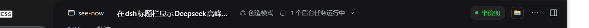
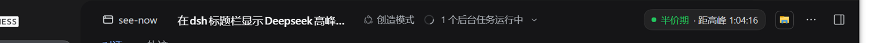

# dsh-price-period

DeepSeek Harness 标题栏里的一枚时段标签：现在的 API 计价是**高峰期**还是**半价期**，跨期不到 30 分钟时带倒计时。

`0.1.0-alpha.1` · MIT · 零运行时依赖 · 不联网 · [](https://github.com/nacivageer/dsh-price-period/actions/workflows/test.yml)





## 它做什么 / 不做什么

| 做 | 不做 |
|---|---|
| 判断此刻是高峰还是半价，按北京时间与官方价目表 | 不显示具体单价，也不估算花费 |
| 距下次切换不足 30 分钟时显示倒计时 | 不做定时任务，到点不提醒你 |
| 节假日/周末全天按半价处理，周末跨期跳到下周一 | 未收录年份不会「猜」节假日——会在标签上打 `⚠` |
| 每秒用本机时钟重算，无网络请求 | 不替你判断「这个任务该不该现在跑」 |

## 安装

前提：DeepSeek Harness **0.2.2-rc.1 或更新的版本**（本插件是纯 Client 插件，只往会话标题栏的 `conversation.session.header.utilities` 塞一个组件）。

```sh
# 桌面版 / CLI 都走这条；profile 名按你自己的改，桌面版默认 desktop
dsh plugin --profile desktop add github:nacivageer/dsh-price-period
```

`dsh` 不在 PATH 里时（桌面版常见）：用安装目录下的 `resources\runtime\cli\bin\dsh.cmd`，或 `npx @deepseek-ai/dsh` 代替命令开头的 `dsh`。

这个包**没有构建步骤**：`client.js` 就是产物，装完不需要 `prepare`、不需要 `allowBuilds` 授权。装完重启 DSH 生效（manifest 不热更新）。

从源码安装（自己改着玩）：

```sh
git clone https://github.com/nacivageer/dsh-price-period
cd dsh-price-period
npm test                        # 12 个时钟用例 + 节假日表校验
npm pack                        # 产出 dsh-price-period-0.1.0-alpha.1.tgz
dsh plugin --profile desktop add ./dsh-price-period-0.1.0-alpha.1.tgz
```

> 不要用 `dsh plugin add .`（目录 link）来分发。pnpm 10 + Windows 下会生成坏的符号链接，且插件真实路径在 profile 树外时运行时解析不到依赖；tarball 与 git 两种形态才和 npm 行为一致。

## 判定口径

来自 DeepSeek 官方价目表（[Models & Pricing](https://api-docs.deepseek.com/quick_start/pricing)）的 off-peak 备注：

- **高峰期**：周一至周五 `09:00–12:00`、`14:00–18:00`（北京时间），中国法定节假日除外。
- **半价期**：其余所有时间——含周末、法定节假日全天。
- 官方英文页写的是 UTC 的 `01:00–04:00` 与 `06:00–10:00`；本插件按 `Asia/Shanghai` 换算成上面两个窗口，**用户机器的时区不影响结论**。
- 「半价」是官方说法（off-peak 为 peak 的一半），不是插件自己起的名。

### 这套表对全球都一样

官方只有一套价目表，用 UTC 写、中文页换算成北京时间，没有任何地区维度。也就是说：**海外用户同样在 UTC 那两个窗口付高峰价，同样在中国法定节假日付半价；他们本地的节日不带来任何折扣。** 所以插件不需要地区设置，固定按北京时间算是唯一自洽的做法——但标签上的「高峰/半价」说的是**中国内地口径**，不是「你所在时区的白天/夜晚」。

### 时间怎么算

- 用浏览器本机时钟，每秒重算一次；不请求 Host，也没有缓存。系统时间错了，标签就跟着错。
- 周五 18:00 之后的「下一个切换」会跳到下周一 09:00，周末两天中间没有切换点。
- 跨期阈值是**严格小于 30 分钟**：`08:30:00` 整不算，`08:30:01` 才开始显示倒计时。

## 法定节假日

唯一真相是仓库里的 [`data/cn-holidays.json`](data/cn-holidays.json)。浏览器端读不了文件，所以 `client.js` 里那段 `HOLIDAYS` 是**生成产物**，由 `tools/sync-holidays.mjs` 从 JSON 写进 `/* <holidays:begin> */ … /* <holidays:end> */` 之间，别手改：

```sh
npm run sync:holidays      # 从 data/ 重写 client.js，并镜像到 ~/.dsh/data/（给 Python 侧用）
npm run check:holidays     # 只校验，不一致 exit 1
```

现行内容（国务院 2026 年放假通知，国办发明电〔2025〕7号）：

| 节日 | 日期 |
|---|---|
| 元旦 | 1/1–1/3 |
| 春节 | 2/15–2/23 |
| 清明 | 4/4–4/6 |
| 劳动节 | 5/1–5/5 |
| 端午 | 6/19–6/21 |
| 中秋 | 9/25–9/27 |
| 国庆 | 10/1–10/7 |

调休上班的周六（如 2/14、2/28、5/9、10/10）**不**单独处理：官方口径是周末一律半价，所以它们本来就是半价。

### 新一年怎么维护

1. 国务院发布次年安排后，把日期加进 `data/cn-holidays.json` 的 `dates`，年份加进 `coveredYears`。
2. `npm run sync:holidays` → `npm test` → 提交。

**没维护会怎样**：`coveredYears` 之外的年份会让标签显示 `⚠`，tooltip 写明「本年节假日表未收录，目前只按周末判断」。工作日里的法定假日会被当成高峰——但你看得见这个 `⚠`，不是无声地算错。

## 测试

```sh
node test/period.test.mjs          # 或 npm test
node tools/sync-holidays.mjs --check
```

测试用假的 `window.__ModuleLoader__` 加载**真实的** `client.js`，通过 `__period` 测试口验证时钟逻辑，不复制一份调度代码；最后逐条比对 `client.js` 的 `HOLIDAYS` / `HOLIDAYS_COVERED` 与 `data/cn-holidays.json`，漂了就失败（读不到文件也是失败，不会静默变绿）。

覆盖：工作日上午/午休/下午、09:00 整点、周五深夜跨周末、周六、2026 国庆（含节前夜跨整个假期）、调休补班的周六、倒计时格式化、覆盖年份标记、未收录年份的降级行为。

## 已知限制

- 只在有会话时可见（slot 是 session 作用域）；空白新会话页没有标题栏，也就没有标签。
- 节假日表是静态数据，国务院通知改了要手动跟；未收录年份见上面的 `⚠`。
- 官方价目表随时可能再调整；这里只表达「高峰/半价」两档，不显示具体单价。
- 本机时钟是唯一依据，没有校时。

## English

A DeepSeek Harness header chip that shows whether the DeepSeek API is currently in **peak** or **off-peak (half-price)** billing, with a live countdown once the next switch is under 30 minutes away.

- Peak: Mon–Fri 09:00–12:00 and 14:00–18:00 Beijing time, excluding Chinese public holidays; everything else (including weekends and holidays in full) is half price.
- One global rate card — being outside mainland China changes your local clock, not the schedule.
- Install: `dsh plugin --profile desktop add github:nacivageer/dsh-price-period`, then restart. No build step, no dependencies, no network calls.
- Chinese public holidays live in `data/cn-holidays.json`; a year missing from `coveredYears` renders a `⚠` instead of guessing silently.
- Source and issues: https://github.com/nacivageer/dsh-price-period

## License

MIT © 2026 72NG
